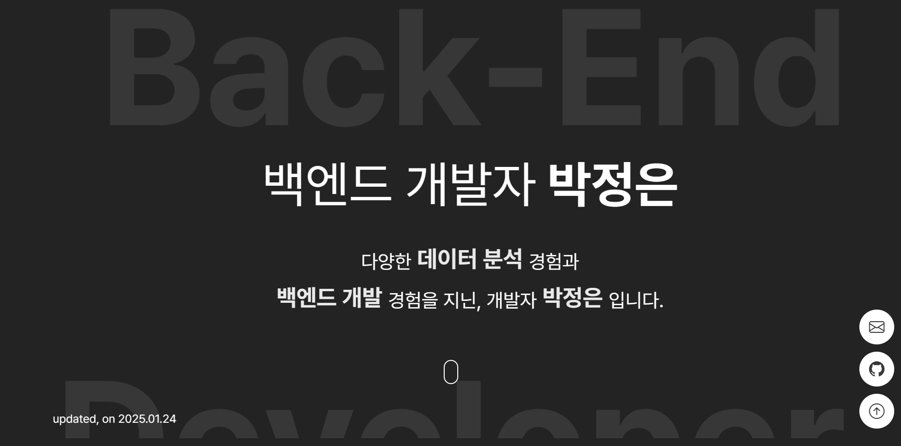

<h1 align="center">
  
</h1>

<h3 align="center">Backend & GIS developer building real-time data services — from data collection to the map, and the servers they run on 🇰🇷</h3>

 

🗺️ Built **ITS traffic control dashboards** and a **venue-safety GIS platform** with OpenLayers & PostGIS

⛓️ Designed **real-time indexers** in Go and run **Linux servers & blockchain nodes** in production

🧭 Heading toward **traffic information systems (ITS / BIS)** people use every day

🎵 Fun fact: **I love rhythm games** and turning real-world data into something you can see on a map

 

<h2 align="center">⚒️ Tech Stack ⚒️</h2>
 

   
   
    
  
  
  
  

 

  <h2>🐍 My Contributions 🐍</h2>
  

<h2 align="center">⚡ Stats ⚡</h2>
 

  
  
   
  

 

<h3 align="center">
  
</h3>
